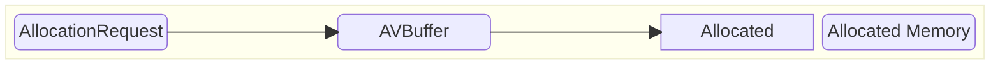
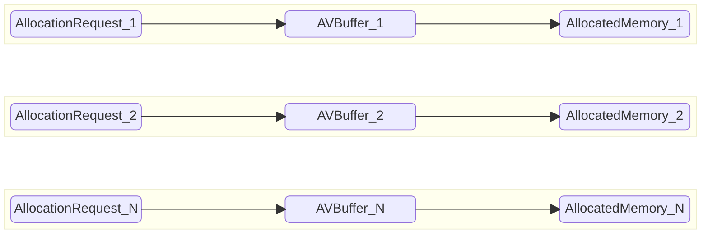

# AV Buffer High Level Test Specification Document

## Table of Contents

- [Acronyms, Terms and Abbreviations](#acronyms-terms-and-abbreviations)
- [Introduction](#introduction)
- [Module Description](#module-description)
- [L3 Test Specification](#l3-test-specification)

## Acronyms, Terms and Abbreviations

- `HAL`    - Hardware Abstraction Layer
- `API`    - Application Programming Interface
- `AIDL`   - Android Interface Definition Language
- `L2`     - Level 2 Testing
- `L3`     - Level 3 Testing
- `ID`     - Identifier
- `AV`     - Audio and Video
- `PCM`    - Pulse Code Modulation.
- `SHA-1`  - Secure Hash Algorithm 1.

## Introduction

This document provides an overview of the testing requirements for the AV Buffer module. It outlines the scope of testing, objectives, testing levels and approaches, and specific test requirements.

- AV Buffer Interface Definitions – [AV Buffer HAL](https://github.com/rdkcentral/rdk-halif-aidl/tree/v0.6/avbuffer/current/com/rdk/hal/avbuffer)

- AV Buffer Overview – [AV Buffer Overview](https://wiki.rdkcentral.com/pages/viewpage.action?spaceKey=RDKHAL&title=AV+Buffer)

## Module Description

The AV Buffer module is responsible for managing memory buffers used in audio and video data processing within the media pipeline. It handles both secure and non-secure memory for storing AV frames.

- **Secure Memory**: Secure memory is used to store decrypted data, such as DRM or conditional access content. It is carefully managed and is only accessible by trusted entities, such as Trusted Applications (TAs) or secure hardware peripherals. General AV Buffer clients cannot access secure memory to ensure data protection.

- **Non-Secure Memory**: Non-secure memory holds encrypted data until it is decrypted. AV Buffer clients can access non-secure memory to perform read-write operations on audio or video buffers.

The module supports the creation and management of audio and video frame pools. These pools store audio or video data and are referenced by a pool handle. The size of each pool is determined by the vendor layer based on the resource `ID` provided during pool creation. Once created, these pools are used to allocate buffers, which can then be freed when no longer needed.

## L3 Test Specification
### Feature List

VTS L3 validates all the AV Buffer features in both sequential and concurrent allocation modes.

#### Sequential Allocation

The Sequential Allocation test evaluates each AV Buffer allocation individually, one after another, to ensure functional correctness across all supported features. This approach helps isolate issues and verify that every AV Buffer allocation performs as expected in a standalone environment.

#### Concurrent Allocation

The Concurrent AV Buffer Allocation test assesses the system's ability to handle multiple AV Buffer allocation operating simultaneously, each configured with different supported features. This test is designed to validate the robustness, resource management, and feature compatibility of the platform under concurrent load, multiple AV Buffer allocations.

The following table outlines the core features validated in the L3 test phase

|#|Testing Feature|Description|
|-|---------------|-----------|
|1|Secure and Non-Secure|Test allocates the buffer in secure mode or non secure mode.
|2|Audio Pool|Test Creates a audio memory buffer pool of a secure or non-secure type from which allocations can be made|
|3|Audio PCM|Test Creates a audio memory buffer pool of a secure or non-secure for system audio PCM|
|4|Audio Decoders|Test Creates a audio memory buffer pool of a secure or non-secure for each valid audio decoder ID|
|5|Video Pool|Test Creates a video memory buffer pool of a secure or non-secure type from which allocations can be made|
|6|Video Decoders|Test Creates a video memory buffer pool of a secure or non-secure for each valid video decoder ID|
|7|Alloc|Test allocates a memory buffer from a given buffer pool|
|8|Notify Space|Callback in response to when the requested space for an allocation becomes available in the pool|
|9|Trim|Test Trims the size of the last allocated block from a pool to a smaller size|
|10|Validate SHA-1|Test calculates , validate the SHA-1 for the data contained inside an AV buffer|
|11|Write And Read|Test Writes a block of data to a memory block at a given offset and read the data at a given offset|
|12|Copy With Map|Test Copies one or more ranges of bytes between memory buffers|
|13|Concurrent Allocation|Test executes multiple AVBuffer allocations simultaneously, validating allocated buffers and their respective metrics|

### Test Cases

The table below summarizes the L3 test cases executed using various configurations.These tests are also executed in a multi-process environment:

|#|Test|Secure|Audio Pool|Audio PCM|Audio Decoders|Video Pool|Video Decoders|Notify space|Trim|Alloc|Validate SHA-1|Write And Read|Copy With Map|Concurrent Allocation|
|-|----|------|----------|---------|--------------|----------|--------------|------------|----|-----|--------------|--------------|-------------|---------------------|
|1|Alloc_Dealloc_Sequential_NonSecure_Audiopool|✘|✔|✘|✘|✘|✘|✘|✘|✘|✘|✘|✘|✘|
|2|Alloc_Dealloc_Sequential_NonSecure_Audiopcm|✘|✔|✔|✘|✘|✘|✘|✘|✘|✘|✘|✘|✘|
|3|Alloc_Dealloc_Sequential_NonSecure_Audiodecoders|✘|✔|✘|✔|✘|✘|✘|✘|✘|✘|✘|✘|✘|
|4|Alloc_Dealloc_Sequential_NonSecure_AudiopoolNotifyspace|✘|✔|✘|✔|✘|✘|✔|✘|✘|✘|✘|✘|✘|
|5|Alloc_Dealloc_Sequential_NonSecure_AudiopoolTrim|✘|✔|✘|✔|✘|✘|✘|✔|✘|✘|✘|✘|✘|
|6|Alloc_Dealloc_Sequential_NonSecure_AudiopoolTrimLargerAlloc|✘|✔|✘|✔|✘|✘|✘|✔|✘|✘|✘|✘|✘|
|7|Alloc_Dealloc_Sequential_NonSecure_AudiopoolAllocInvalidsize|✘|✔|✘|✔|✘|✘|✘|✘|✔|✘|✘|✘|✘|
|8|Alloc_Dealloc_Sequential_NonSecure_AudiopoolWriteAndRead|✘|✔|✘|✔|✘|✘|✘|✘|✘|✘|✔|✘|✘|
|9|Alloc_Dealloc_Sequential_NonSecure_AudiopoolCopyWithMap|✘|✔|✘|✔|✘|✘|✘|✘|✘|✘|✘|✔|✘|
|10|Alloc_Dealloc_Sequential_NonSecure_Videopool|✘|✘|✘|✘|✔|✘|✘|✘|✘|✘|✘|✘|✘|
|11|Alloc_Dealloc_Sequential_NonSecure_Videdecoders|✘|✘|✘|✘|✔|✔|✘|✘|✘|✘|✘|✘|✘|
|12|Alloc_Dealloc_Sequential_NonSecure_VideopoolNotifyspace|✘|✘|✘|✘|✔|✔|✔|✘|✘|✘|✘|✘|✘|
|13|Alloc_Dealloc_Sequential_NonSecure_VideopoolTrim|✘|✘|✘|✘|✔|✔|✘|✔|✘|✘|✘|✘|✘|
|14|Alloc_Dealloc_Sequential_NonSecure_VideopoolAllocInvalidsize|✘|✘|✘|✘|✔|✔|✘|✘|✔|✘|✘|✘|✘|
|15|Alloc_Dealloc_Sequential_NonSecure_VideopoolWriteAndRead|✘|✘|✘|✘|✔|✔|✘|✘|✘|✘|✔|✘|✘|
|16|Alloc_Dealloc_Sequential_NonSecure_VideopoolCopyWithMap|✘|✘|✘|✘|✔|✔|✘|✘|✘|✘|✘|✔|✘|
|17|Alloc_Dealloc_Sequential_Secure_Audiopool|✔|✔|✘|✘|✘|✘|✘|✘|✘|✘|✘|✘|✘|
|18|Alloc_Dealloc_Sequential_Secure_Audiopcm|✔|✔|✔|✘|✘|✘|✘|✘|✘|✘|✘|✘|✘|
|19|Alloc_Dealloc_Sequential_Secure_Audiodecoders|✔|✔|✘|✔|✘|✘|✘|✘|✘|✘|✘|✘|✘|
|20|Alloc_Dealloc_Sequential_Secure_AudiopoolNotifyspace|✔|✔|✘|✔|✘|✘|✔|✘|✘|✘|✘|✘|✘|
|21|Alloc_Dealloc_Sequential_Secure_AudiopoolTrim|✔|✔|✘|✔|✘|✘|✘|✔|✘|✘|✘|✘|✘|
|22|Alloc_Dealloc_Sequential_Secure_AudiopoolTrimLargerAlloc|✔|✔|✘|✔|✘|✘|✘|✔|✘|✘|✘|✘|✘|
|23|Alloc_Dealloc_Sequential_Secure_AudiopoolAllocInvalidsize|✔|✔|✘|✔|✘|✘|✘|✘|✔|✘|✘|✘|✘|
|24|Alloc_Dealloc_Sequential_Secure_AudiopoolValidateSHA1|✔|✔|✘|✔|✘|✘|✘|✘|✘|✔|✘|✘|✘|
|25|Alloc_Dealloc_Sequential_Secure_Videopool|✔|✘|✘|✘|✔|✘|✘|✘|✘|✘|✘|✘|✘|
|26|Alloc_Dealloc_Sequential_Secure_Videdecoders|✔|✘|✘|✘|✔|✔|✘|✘|✘|✘|✘|✘|✘|
|27|Alloc_Dealloc_Sequential_Secure_VideopoolNotifyspace|✔|✘|✘|✘|✔|✔|✔|✘|✘|✘|✘|✘|✘|
|28|Alloc_Dealloc_Sequential_Secure_VideopoolTrim|✔|✘|✘|✘|✔|✔|✘|✔|✘|✘|✘|✘|✘|
|29|Alloc_Dealloc_Sequential_Secure_VideopoolAllocInvalidsize|✔|✘|✘|✘|✔|✔|✘|✘|✔|✘|✘|✘|✘|
|30|Alloc_Dealloc_Sequential_Secure_VideopoolValidateSHA1|✔|✘|✘|✘|✔|✔|✘|✘|✘|✔|✘|✘|✘|
|31|Alloc_Dealloc_Concurrent_NonSecure_Audiopool|✘|✔|✘|✘|✘|✘|✘|✘|✘|✘|✘|✘|✔|
|32|Alloc_Dealloc_Concurrent_NonSecure_Audiopcm|✘|✔|✔|✘|✘|✘|✘|✘|✘|✘|✘|✘|✔|
|33|Alloc_Dealloc_Concurrent_NonSecure_Audiodecoders|✘|✔|✘|✔|✘|✘|✘|✘|✘|✘|✘|✘|✔|
|34|Alloc_Dealloc_Concurrent_NonSecure_AudiopoolNotifyspace|✘|✔|✘|✔|✘|✘|✔|✘|✘|✘|✘|✘|✔|
|35|Alloc_Dealloc_Concurrent_NonSecure_AudiopoolTrim|✘|✔|✘|✔|✘|✘|✘|✔|✘|✘|✘|✘|✔|
|36|Alloc_Dealloc_Concurrent_NonSecure_AudiopoolTrimLargerAlloc|✘|✔|✘|✔|✘|✘|✘|✔|✘|✘|✘|✘|✔|
|37|Alloc_Dealloc_Concurrent_NonSecure_AudiopoolAllocInvalidsize|✘|✔|✘|✔|✘|✘|✘|✘|✔|✘|✘|✘|✔|
|38|Alloc_Dealloc_Concurrent_NonSecure_AudiopoolWriteAndRead|✘|✔|✘|✔|✘|✘|✘|✘|✘|✘|✔|✘|✔|
|39|Alloc_Dealloc_Concurrent_NonSecure_AudiopoolCopyWithMap|✘|✔|✘|✔|✘|✘|✘|✘|✘|✘|✘|✔|✔|
|40|Alloc_Dealloc_Concurrent_NonSecure_Videopool|✘|✘|✘|✘|✔|✘|✘|✘|✘|✘|✘|✘|✔|
|41|Alloc_Dealloc_Concurrent_NonSecure_Videdecoders|✘|✘|✘|✘|✔|✔|✘|✘|✘|✘|✘|✘|✔|
|42|Alloc_Dealloc_Concurrent_NonSecure_VideopoolNotifyspace|✘|✘|✘|✘|✔|✔|✔|✘|✘|✘|✘|✘|✔|
|43|Alloc_Dealloc_Concurrent_NonSecure_VideopoolTrim|✘|✘|✘|✘|✔|✔|✘|✔|✘|✘|✘|✘|✔|
|44|Alloc_Dealloc_Concurrent_NonSecure_VideopoolAllocInvalidsize|✘|✘|✘|✘|✔|✔|✘|✘|✔|✘|✘|✘|✔|
|45|Alloc_Dealloc_Concurrent_NonSecure_VideopoolWriteAndRead|✘|✘|✘|✘|✔|✔|✘|✘|✘|✘|✔|✘|✔|
|46|Alloc_Dealloc_Concurrent_NonSecure_VideopoolCopyWithMap|✘|✘|✘|✘|✔|✔|✘|✘|✘|✘|✘|✔|✔|
|47|Alloc_Dealloc_Concurrent_Secure_Audiopool|✔|✔|✘|✘|✘|✘|✘|✘|✘|✘|✘|✘|✔|
|48|Alloc_Dealloc_Concurrent_Secure_Audiopcm|✔|✔|✔|✘|✘|✘|✘|✘|✘|✘|✘|✘|✔|
|49|Alloc_Dealloc_Concurrent_Secure_Audiodecoders|✔|✔|✘|✔|✘|✘|✘|✘|✘|✘|✘|✘|✔|
|50|Alloc_Dealloc_Concurrent_Secure_AudiopoolNotifyspace|✔|✔|✘|✔|✘|✘|✔|✘|✘|✘|✘|✘|✔|
|51|Alloc_Dealloc_Concurrent_Secure_AudiopoolTrim|✔|✔|✘|✔|✘|✘|✘|✔|✘|✘|✘|✘|✔|
|52|Alloc_Dealloc_Concurrent_Secure_AudiopoolTrimLargerAlloc|✔|✔|✘|✔|✘|✘|✘|✔|✘|✘|✘|✘|✔|
|53|Alloc_Dealloc_Concurrent_Secure_AudiopoolAllocInvalidsize|✔|✔|✘|✔|✘|✘|✘|✘|✔|✘|✘|✘|✔|
|54|Alloc_Dealloc_Concurrent_Secure_AudiopoolValidateSHA1|✔|✔|✘|✔|✘|✘|✘|✘|✘|✔|✘|✘|✔|
|55|Alloc_Dealloc_Concurrent_Secure_Videopool|✔|✘|✘|✘|✔|✘|✘|✘|✘|✘|✘|✘|✔|
|56|Alloc_Dealloc_Concurrent_Secure_Videdecoders|✔|✘|✘|✘|✔|✔|✘|✘|✘|✘|✘|✘|✔|
|57|Alloc_Dealloc_Concurrent_Secure_VideopoolNotifyspace|✔|✘|✘|✘|✔|✔|✔|✘|✘|✘|✘|✘|✔|
|58|Alloc_Dealloc_Concurrent_Secure_VideopoolTrim|✔|✘|✘|✘|✔|✔|✘|✔|✘|✘|✘|✘|✔|
|59|Alloc_Dealloc_Concurrent_Secure_VideopoolAllocInvalidsize|✔|✘|✘|✘|✔|✔|✘|✘|✔|✘|✘|✘|✔|
|60|Alloc_Dealloc_Concurrent_Secure_VideopoolValidateSHA1|✔|✘|✘|✘|✔|✔|✘|✘|✘|✔|✘|✘|✔|