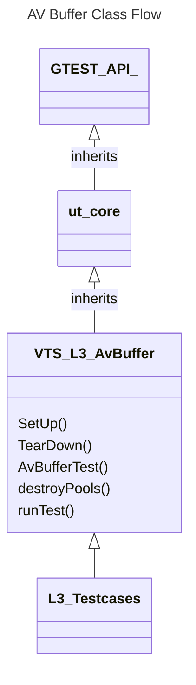
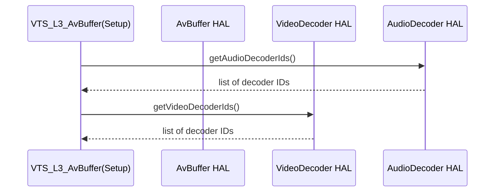
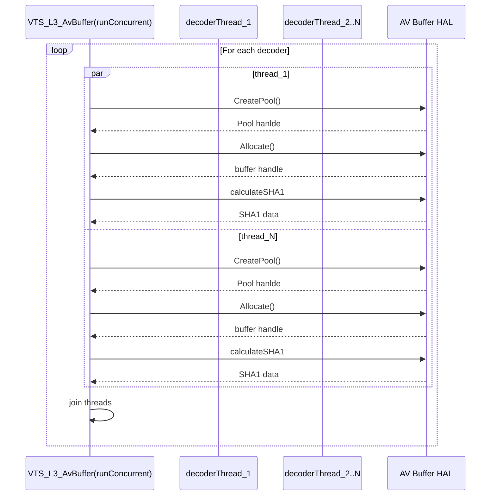

# AV BUFFER L3 Low Level Test Specification and Procedure Documentation

## Table of Contents

- [Overview](#overview)
- [Acronyms, Terms and Abbreviations](#acronyms-terms-and-abbreviations)
- [References](#references)
- [Class Design](#class-design)
- [Common Validation Functions](#common-validation-functions)
- [L3 Tests](#l3-tests)


## Acronyms, Terms and Abbreviations

- `HAL` \- Hardware Abstraction Layer, may include some common components
- `UT`  \- Unit Test(s)
- `YAML` \- Yet Another Markup Language
- `URL` \- Uniform Resource Locator

## Overview

This document outlines the L3 test design for the AV Buffer module.

## References

- High Level Test Specification - [avBuffer_High-Level_TestSpecification.md](avBuffer_High-Level_TestSpecification.md)
- AV Buffer Interface Definitions - [AV Buffer HAL](https://github.com/rdkcentral/rdk-halif-aidl/tree/v0.6/avbuffer/current/com/rdk/hal/avbuffer)
- AV Buffer Overview - [AV Buffer Overview](https://rdkcentral.github.io/rdk-halif-aidl/halif/av_buffer/current/av_buffer/)


## Class Design

This test suite is designed using an object-oriented approach, leveraging the C++ variant of the `ut-core` testing framework. The following class structure and interaction model supports robust test orchestration, concurrent execution, and decoder validation.

### Primary Classes

|#|Class|Description|
|-|-----|-----------|
|1|VTS_L3_AvBuffer|Test class which contains the test cases implementation|
|2|AVBufferSpaceListener|AvBuffer listener class to observe onSpaceAvailable Event.|

### VTS_L3_AvBuffer Class

The L3 av buffer tests are implemented using the C++ variant of `ut-core`. For more information on the framework, refer to [ut-core](https://github.com/rdkcentral/ut-core/blob/4.7.0/README.md)

The following class diagram shows the inheritance structure and configuration dependencies for the test suite:


#### VTS_L3_AvBuffer Class Functions

The class overrides `SetUp()` and `TearDown()` from `ut_core` to handle initialization and clean-up common to all test cases

|#|Function|Arguments|Description|HAL API|
|-|--------|---------|-----------|-------|
|1|Setup|None|Initializes the test by acquiring service handles, supported decoder IDs, decoder capabilities, and registering event listeners|`getAvBufferIds()`<br>`getAvBuffer()`<br>`registerEventListener()`<br>`getCapabilities()`|
|2|TearDown|None|Cleans up by unregistering event listeners|`unregisterEventListener()`|
|3|AvBufferTest|AudioDecoderId, VideoDecoderId,testConfig|Create pol, allocate, trim, write and read data and get SHA1 data as per teh test configuration parameter|`getHeapMetrics()`|
|4|destroyPools|TestConfig|Destroys all teh pools and allocation created during `AvBufferTest()`|`getHeapMetrics()`|
|5|runTest|bool isAudio, bool isConcurrent,unit8_t testConfig|If `concurrentMode` is enabled, this function invokes threads; otherwise, it calls `AvBufferTest()` with parameter for each decoderIds||

#### Setup

The following sequence diagram illustrates the flow of the `Setup` function:


#### TearDown

```mermaid
```

#### runSequentialTest

The following sequence diagram illustrates the flow of the `runSequentialDecode` function:

```mermaid
sequenceDiagram
  participant avbuffer as VTS_L3_AvBuffer(runSequential)
  participant buffer as AV Buffer HAL

  loop For each decoder
    avbuffer->>buffer : CreatePool()
    buffer -->> avbuffer: Pool hanlde
    avbuffer->>buffer: Allocate()
    buffer-->>avbuffer: buffer handle
    avbuffer->>buffer : calculateSHA1
    buffer -->> avbuffer: SHA1 data
  end
```

#### runConcurrentTest

The following sequence diagram illustrates the flow of the `runConcurrentDecode` function:



## L3 Tests

The L3 tests validate the functional correctness and performance of the AvBuffer HAL by simulating real-world decoding workflows. Each test calls `runTest` with different parameters. `Test Configuration Controls` describes the control parameters used from test configuration file `vts_l3_test_config.yaml`

|#|Test|function|Arguments|Test Configuration Controls|
|-|----|--------|---------|---------------------------|
|1|seq_nonsec_audiopool|runTest()|isAudio = true<br>concurrentMode=false|NA|
|2|seq_nonsec_audiopoolpcm|runTest()|isAudio = true<br>concurrentMode=false|NA|
|3|seq_nonsec_audiopool_alloc|runTest()|isAudio = true<br>concurrentMode=false|NA|
|4|seq_nonsec_audiopool_trim|runTest()|isAudio = true<br>concurrentMode=false|NA|
|5|seq_nonsec_audiopool_notify|runTest()|isAudio = true<br>concurrentMode=false|NA|
|6|seq_nonsec_audiopool_readwrite|runTest()|isAudio = true<br>concurrentMode=false|NA|
|7|seq_nonsec_audiopool_sha1|runTest()|isAudio = true<br>concurrentMode=false|NA|
|8|seq_sec_audiopool|runTest()|isAudio = true<br>concurrentMode=false|NA|
|9|seq_sec_audiopoolpcm|runTest()|isAudio = true<br>concurrentMode=false|NA|
|10|seq_sec_audiopool_alloc|runTest()|isAudio = true<br>concurrentMode=false|NA|
|11|seq_sec_audiopool_trim|runTest()|isAudio = true<br>concurrentMode=false|NA|
|12|seq_sec_audiopool_notify|runTest()|isAudio = true<br>concurrentMode=false|NA|
|13|seq_sec_audiopool_readwrite|runTest()|isAudio = true<br>concurrentMode=false|NA|
|14|seq_sec_audiopool_sha1|runTest()|isAudio = true<br>concurrentMode=false|NA|
|15|con_nonsec_audiopool|runTest()|isAudio = true<br>concurrentMode=true|NA|
|16|con_nonsec_audiopool_alloc|runTest()|isAudio = true<br>concurrentMode=true|NA|
|17|con_nonsec_audiopool_trim|runTest()|isAudio = true<br>concurrentMode=true|NA|
|18|con_nonsec_audiopool_notify|runTest()|isAudio = true<br>concurrentMode=true|NA|
|19|con_nonsec_audiopool_readwrite|runTest()|isAudio = true<br>concurrentMode=true|NA|
|20|con_nonsec_audiopool_sha1|runTest()|isAudio = true<br>concurrentMode=true|NA|
|21|con_sec_audiopool|runTest()|isAudio = true<br>concurrentMode=true|NA|
|22|con_sec_audiopool_alloc|runTest()|isAudio = true<br>concurrentMode=true|NA|
|23|con_sec_audiopool_trim|runTest()|isAudio = true<br>concurrentMode=true|NA|
|24|con_sec_audiopool_notify|runTest()|isAudio = true<br>concurrentMode=true|NA|
|25|con_sec_audiopool_readwrite|runTest()|isAudio = true<br>concurrentMode=true|NA|
|26|con_sec_audiopool_sha1|runTest()|isAudio = true<br>concurrentMode=true|NA|
|27|seq_nonsec_videopool|runTest()|isAudio = false<br>concurrentMode=false|NA|
|28|seq_nonsec_videopool_alloc|runTest()|isAudio = false<br>concurrentMode=false|NA|
|29|seq_nonsec_videopool_trim|runTest()|isAudio = false<br>concurrentMode=false|NA|
|30|seq_nonsec_videopool_notify|runTest()|isAudio = false<br>concurrentMode=false|NA|
|31|seq_nonsec_videopool_readwrite|runTest()|isAudio = false<br>concurrentMode=false|NA|
|32|seq_nonsec_videopool_sha1|runTest()|isAudio = false<br>concurrentMode=false|NA|
|33|seq_sec_videopool|runTest()|isAudio = false<br>concurrentMode=false|NA|
|34|seq_sec_videopool_alloc|runTest()|isAudio = false<br>concurrentMode=false|NA|
|35|seq_sec_videopool_trim|runTest()|isAudio = false<br>concurrentMode=false|NA|
|36|seq_sec_videopool_notify|runTest()|isAudio = false<br>concurrentMode=false|NA|
|37|seq_sec_videopool_readwrite|runTest()|isAudio = false<br>concurrentMode=false|NA|
|38|seq_sec_videopool_sha1|runTest()|isAudio = false<br>concurrentMode=false|NA|
|39|con_nonsec_videopool|runTest()|isAudio = false<br>concurrentMode=true|NA|
|40|con_nonsec_videopool_alloc|runTest()|isAudio = false<br>concurrentMode=true|NA|
|41|con_nonsec_videopool_trim|runTest()|isAudio = false<br>concurrentMode=true|NA|
|42|con_nonsec_videopool_notify|runTest()|isAudio = false<br>concurrentMode=true|NA|
|43|con_nonsec_videopool_readwrite|runTest()|isAudio = false<br>concurrentMode=true|NA|
|44|con_nonsec_videopool_sha1|runTest()|isAudio = false<br>concurrentMode=true|NA|
|45|con_sec_videopool|runTest()|isAudio = false<br>concurrentMode=true|NA|
|46|con_sec_videopool_alloc|runTest()|isAudio = false<br>concurrentMode=true|NA|
|47|con_sec_videopool_trim|runTest()|isAudio = false<br>concurrentMode=true|NA|
|48|con_sec_videopool_notify|runTest()|isAudio = false<br>concurrentMode=true|NA|
|49|con_sec_videopool_readwrite|runTest()|isAudio = false<br>concurrentMode=true|NA|
|50|con_sec_videopool_sha1|runTest()|isAudio = false<br>concurrentMode=true|NA|